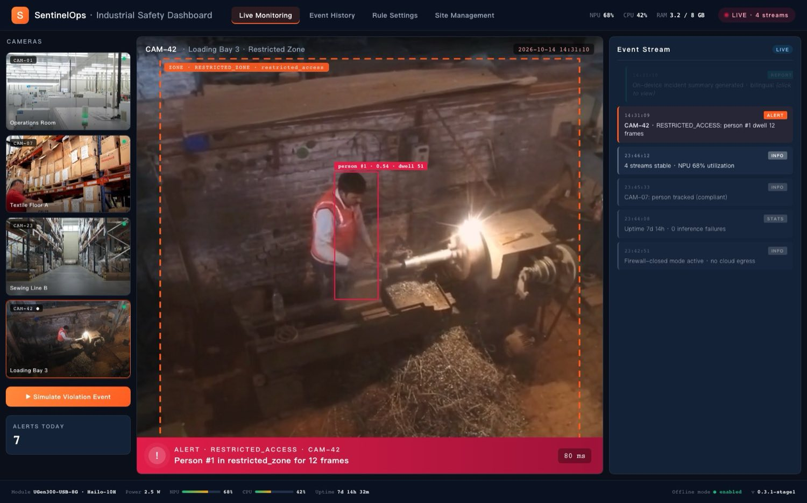
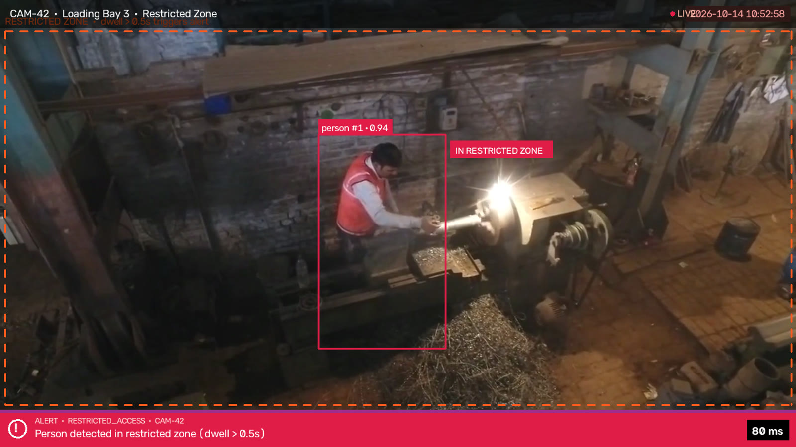

# SentinelEdge

On-prem industrial safety analytics for the ASUS UGen300 USB AI Accelerator (Hailo-10H NPU).


**SentinelEdge** is a reference application for the ASUS **UGen300-USB-8G** (Hailo-10H NPU, 40 TOPS @ INT4 / 20 TOPS @ INT8, 2.5 W typical, 8 GB LPDDR4). It reads existing RTSP camera feeds, runs PPE / zone-rule detection on the NPU, and uses a small on-device LLM to produce bilingual (English + Traditional Chinese) incident reports. Everything runs on-prem; no video leaves the LAN.

Stage I submission for the **2026 ASUS UGen AI League — Battlefield Lightning × Workplace AI**.

---

**SentinelOps web dashboard** — 4-stream monitoring · event stream · rule editor · multi-site · `open webdemo/index.html`



**Live inference** — on-device object detection + multi-object tracking + rule engine on laptop CPU · ~30 ms per frame · `python scripts/demo.py`



---

## Scope

- **Covered**: PPE compliance detection (helmet, hi-vis vest), polygon zone rules (restricted access, dwell timer, lone-worker-forbidden), bilingual incident reporting via MQTT / LINE Notify / Teams Webhook.
- **Stage II**: Hailo HEF compilation + INT8 quantization, pose-estimation integration (dangerous actions), multi-stream performance measurement, pilot deployments.
- **Deliberate omissions**: cloud sync, full video retention UI, user management. Shipping without them keeps the attack surface and operational cost low.

## Architecture

```
         ┌── Host mini-PC or laptop (x86 / ARM) ────────┐
         │                                                │
RTSP ──▶ │  FFmpeg decode → frame batcher                │
         │             │                                  │
         │             ▼                                  │
         │   ┌──────────────────────────┐                 │
         │   │  UGen300 USB (USB-C)     │ 40/20 TOPS      │
         │   │  Hailo-10H NPU           │ @ 2.5 W         │
         │   │  • Object detector (PPE) │ 8 GB LPDDR4     │
         │   │  • Pose estimator (Stage II)              │
         │   └──────────┬───────────────┘                 │
         │              ▼                                  │
         │   Rule / zone engine (Python, <1 ms)           │
         │              │ event                            │
         │              ▼                                  │
         │   On-device LLM — bilingual incident summary   │
         │              │                                  │
         │              ▼                                  │
         │   MQTT · LINE Notify · Teams · siren · log     │
         └────────────────────────────────────────────────┘
```

End-to-end budget (Stage II target): frame → alert ≈ 80 ms. Written report in 1–2 s. The alert path never waits on LLM generation.

## Repository layout

```
.
├── src/
│   ├── inference.py        # End-to-end runtime loop
│   ├── detectors.py        # Torch (Stage I) / Hailo (Stage II) backend
│   ├── rule_engine.py      # Polygon zones, dwell counters, PPE rules
│   ├── reporter.py         # Local bilingual LLM reporter (template fallback)
│   └── outputs.py          # MQTT / LINE / Teams sinks
├── scripts/
│   ├── demo.py             # Live OpenCV demo with real object-detector inference
│   ├── bench_torch.py      # Torch backend latency / FPS benchmark
│   ├── export_onnx.py      # Export detector / pose to ONNX for Hailo
│   └── compile_hailo.sh    # Reference Hailo Dataflow Compiler flow
├── tests/
│   ├── test_rule_engine.py # Polygon + dwell + helmet-overlap tests
│   └── test_reporter.py    # Template-fallback smoke tests
├── configs/
│   └── site_example.yaml   # Per-site config (zones, rules, outputs)
├── assets/
│   └── sample_factory.mp4  # 8s CCTV-style sample used by scripts/demo.py
├── webdemo/                # Static web-based SentinelOps dashboard mockup
│   ├── index.html          # Dashboard shell: 4 tabs, 4 cams, event stream
│   ├── css/style.css       # ASUS-orange corporate style
│   ├── js/app.js           # Tab routing, event trigger, modal, LINE popup
│   └── assets/videos/      # Four looping camera feeds (CAM-01/07/23/42)
├── benchmark.md            # Reference baselines + Stage II target table
└── requirements.txt
```

## Quickstart

### Install

```bash
python -m venv .venv
source .venv/bin/activate
pip install -r requirements.txt
```

### Run the unit tests (fast, no model download)

```bash
pytest tests/ -v
```

Expected: `8 passed in <1s`. These exercise the rule-engine geometry, dwell counters, and the reporter's template-fallback path — none of them require model weights or hardware.

### Open the web dashboard (no install needed)

```bash
open webdemo/index.html     # macOS
# or just double-click the file in Finder / Explorer
```

A standalone static HTML / CSS / JS dashboard that mirrors the production SentinelOps UI — four live camera feeds (CAM-01 / 07 / 23 / 42), event stream panel, LLM report modal, LINE Notify popup, and four tabs (Live Monitoring / Event History / Rule Settings / Site Management). The **▶ Simulate Violation Event** button triggers a full detection → alert → report → push sequence against the real camera footage. No build step, no backend; opens straight from `file://`.

### Try the live demo (recommended for reviewers)

```bash
python scripts/demo.py
```

This is the fastest way to see the pipeline end-to-end *with real inference*. It uses the bundled `assets/sample_factory.mp4`, loads the lightweight object detector, and opens an OpenCV window that mirrors the production dashboard — orange detection boxes with per-person track IDs, dashed `RESTRICTED ZONE` overlay, a sliding red alert ribbon when a person dwells past the threshold, and bilingual EN + ZH incident reports printed to stdout. Every triggered event is appended to `results/events.jsonl`.

The Stage I demo uses the `restricted_access` rule because the shipped COCO weights only expose a `person` class. The rule engine already supports `helmet_mandatory`, `reflective_vest_mandatory`, and `lone_worker_forbidden`; Stage II flips the rule in `configs/site_example.yaml` once a helmet-trained checkpoint is in place.

### Run the headless inference loop (advanced)

For reviewers who want to see the production entry-point rather than the OpenCV demo, `src/inference.py` is the same pipeline without the window:

```bash
# Prerequisite: a lightweight detector checkpoint in the working directory
# (auto-downloaded on first run — ~6 MB)

# Against a local video file (quickest for review)
python -m src.inference \
    --source results/sample_factory.mp4 \
    --config configs/site_example.yaml \
    --backend torch

# Against an RTSP source
python -m src.inference \
    --source rtsp://<your-cam>/stream \
    --config configs/site_example.yaml \
    --backend torch
```

Events print to stdout and are dispatched via any output sink enabled in `configs/site_example.yaml` (MQTT / LINE Notify / Teams Webhook — all `null` by default so no network calls happen out of the box).

For the LLM report path, drop a `qwen2.5-0.5b.gguf` under `reporter.model_path` in the config. If no model file is present the reporter falls back to a deterministic rule-aware template.

Flags:
- `--source path/to/video.mp4` — use your own clip
- `--headless` — skip the window (CI-friendly)
- `--conf 0.4` — adjust detector confidence

Press `q` or `Esc` to quit.

### Benchmark the Torch backend on your machine

```bash
python scripts/bench_torch.py --iters 20 --device auto
# → results/bench_torch.json
```

First run will download a lightweight object-detector checkpoint (~6 MB) into the current directory.

### Export ONNX for Hailo compilation (Stage II prep)

```bash
python scripts/export_onnx.py
# → artifacts/detector.onnx, artifacts/pose.onnx
```

### Reference Hailo compile flow (requires Hailo DFC — Stage II)

See [`scripts/compile_hailo.sh`](scripts/compile_hailo.sh). The sequence is:

```
hailo parser onnx → hailo optimize (INT8 calibration) → hailo compiler → .hef
```

Not expected to run locally without the Hailo Dataflow Compiler; included to document the intended Stage II pipeline for reviewers who want to see the compile path.

## Benchmarks

Reference FP32 baselines and Stage II INT8-on-Hailo-10H targets are tracked in [`benchmark.md`](benchmark.md). Nothing in this repo is currently claimed as measured on real UGen300 hardware; those numbers will be filled in during Stage II alongside the HEF artifacts.

## Roadmap

- **Oct 14, 2026** — Stage I submission bundle (this repo + pitch deck + demo video).
- **Nov 6 – Dec 18, 2026** — Stage II on real hardware: Hailo HEF compilation, INT8 accuracy on CHV / SH17 / Pictor-v3, multi-stream throughput, LLM report integration, MQTT / LINE dispatch verification.
- **Dec 19, 2026** — Finals demo at ASUS HQ, Taipei.
- **Q1 2027** — Pilot field validation at 2–3 manufacturing sites.

## Team

Four-person team covering the following roles:

- AI Architect
- Computer Vision Engineer
- Data Scientist
- LLM Engineer

Team members are listed on the Stage I submission pitch deck.

## Licensing & Attribution

Code: Apache 2.0. Upstream model and runtime licenses:

- Open-source object detection framework — AGPL-3.0 (commercial license available from the upstream vendor for productization)
- Qwen2.5-0.5B — Apache 2.0
- llama.cpp — MIT
- Hailo Dataflow Compiler / HailoRT — vendor license (Stage II access via ASUS / Hailo partnership)

Demo video samples auto-downloaded by `scripts/demo.py` are stock footage from Pexels (Pexels License — free for commercial and non-commercial use with no attribution required). Reviewers who prefer their own footage can pass `--source path/to/video.mp4`.
